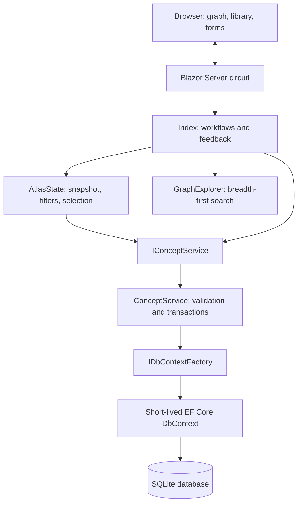
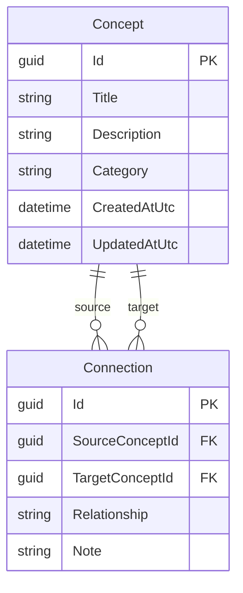

# Architecture and Design

## Purpose and scope

Memory Palace helps students organize concise concepts and explain relationships between them. A spatial graph supports exploration; a searchable library provides a text-based view of the same data. Shortest-path discovery makes connections between subjects explicit.

The application follows a layered design within one web project. Domain entities represent concepts and relationships; the service layer owns validation and persistence workflows; Razor components implement presentation; a scoped state container coordinates the current workspace. A separate pure graph algorithm supports testing without a database or browser.

## System pipeline

Blazor Server executes event handlers on the server and sends UI updates over its built-in circuit connection. This avoids a separate REST API for the coursework scope. It also means that the browser needs a connection to the running server. The application does not implement a custom SignalR hub or broadcast changes between independent circuits; the refresh action reloads another tab's changes.

## Components and scoped state

| Component | Responsibility | Communication |
|---|---|---|
| `Index` | Coordinates workflows, loading, dialogs, and user feedback | Injected services and callbacks |
| `KnowledgeGraph` | Renders directed edges, nodes, and the selected path | Parameters and `EventCallback<Guid>` |
| `ConceptDetails` | Displays metadata and incoming/outgoing relationships | Cascading `AtlasState`, action callbacks |
| `ConceptEditor` | Collects and validates concept fields | Input parameters and typed save callback |
| `ConnectionEditor` | Collects endpoint, type, and note | Input parameters and typed save callback |
| `Modal` | Native dialog, focus containment, and Escape dismissal | Child content and close callback |

`AtlasState` is registered as scoped, which in interactive Blazor Server gives each circuit its own filters, selected concept, and snapshot. It caches the filtered list, categories, and global counts when data or filters change. After a mutation, the page reloads the snapshot and clears obsolete path results. Removed selections and categories are reset. `Index` unsubscribes from the state's `Changed` event when disposed.

UI actions use a busy guard to prevent duplicate submissions within a circuit. This is separate from database concurrency: other circuits may still read and write the shared database.

## DbContext lifetime and concurrency

A scoped `DbContext` would live for the duration of a Blazor circuit and could be shared by overlapping event handlers. EF Core contexts are not thread-safe. `ConceptService` therefore uses `IDbContextFactory<MemoryPalaceDbContext>` to create and asynchronously dispose a context for each operation, following [Microsoft's Blazor and EF Core guidance](https://learn.microsoft.com/en-us/aspnet/core/blazor/blazor-ef-core?view=aspnetcore-10.0).

Reads use `AsNoTracking`; detailed endpoint loading uses split queries. Concept writes, connection creation, deletion, and restore use explicit transactions where multiple steps must succeed together. SQLite serializes writers. A lock or conflicting write produces recoverable user feedback; there is no automatic retry or merge. Concurrent edits use a last-successful-write policy because the model does not include an optimistic concurrency token.

## Domain model

Each concept has an application-generated GUID and UTC creation/update timestamps. A connection has one source, one target, a relationship type, and an optional note. Relationship types are stored as strings in SQLite and as enum numbers in backup JSON.

### Integrity rules

- Titles contain 2–100 characters, descriptions at most 2,000, and categories 2–40.
- Titles and categories are trimmed and normalized to Unicode Form C. Title uniqueness is checked with ordinal case-insensitive comparison in the service, within the write transaction. The title database index is not a unique constraint.
- Relationship endpoints must exist and must differ. Notes contain at most 500 characters. Enum values must be defined.
- A unique database index on `(SourceConceptId, TargetConceptId)` prevents duplicate directed pairs. The reverse pair is allowed.
- The source foreign key uses cascade deletion; the target foreign key restricts deletion. The service explicitly deletes both incoming and outgoing edges before deleting a concept in the same transaction.
- Length limits are validated in the service as well as described by EF metadata; SQLite does not enforce `HasMaxLength` as a character limit.

`EnsureCreatedAsync` initializes a new database. The current changes preserve the existing entity schema. Future schema changes require migrations rather than relying on initial-creation behavior.

## Service contract

There is no public HTTP API. Components depend on `IConceptService`; every method supports a cancellation token.

| Method | Contract |
|---|---|
| `GetAllAsync(search, cancellationToken)` | Return concepts with outgoing edges, optionally filtered by case-insensitive text search |
| `GetByIdAsync(id, cancellationToken)` | Return one concept with incoming/outgoing relationships and endpoint details, or null |
| `CreateAsync(title, description, category, cancellationToken)` | Normalize and validate input, reject duplicate titles, create a concept |
| `UpdateAsync(id, title, description, category, cancellationToken)` | Validate and update an existing concept while preserving its creation timestamp |
| `DeleteAsync(id, cancellationToken)` | Atomically remove a concept and incident edges; return false if absent |
| `ConnectAsync(source, target, relationship, note, cancellationToken)` | Validate and create a directed relationship |
| `DisconnectAsync(id, cancellationToken)` | Idempotently remove a relationship |
| `ExportAsync(cancellationToken)` | Return a version 1 JSON snapshot with flat records |
| `ImportAsync(json, cancellationToken)` | Validate a backup and restore it atomically into an empty atlas |

Invalid user input raises `ArgumentException`, which the page displays as actionable feedback. Unexpected exceptions are logged server-side; the UI displays a generic retry message instead of an exception dump.

## Backup format and restore

The root object contains case-sensitive fields `Version`, `Concepts`, and `Connections`. Records use standard `System.Text.Json` GUID and date encodings. Export uses flat records rather than EF navigation properties, avoiding cyclic serialization.

Restore validates the version, counts, required fields, normalized title uniqueness, GUIDs, timestamp ordering, endpoint references, relation values, and duplicate pairs before writing. It checks that the database is empty inside the transaction. It inserts the complete validated set and commits once; an error rolls back the operation. The UI limits uploads to 2 MB; the service limits data to 2,000 concepts and 10,000 connections. See [demo-atlas.json](demo-atlas.json) for an example.

## BFS and resource use

`GraphExplorer` builds an undirected adjacency list from the directed relationships. It uses a queue and a predecessor table to visit each reachable vertex at most once. On reaching the destination, it reconstructs the path backwards and reverses it. Missing endpoints and disconnected components return an empty result. A concept connected to itself by a zero-step request returns a single-vertex path.

For V vertices and E edges, time and auxiliary space are **O(V + E)**. Direction is ignored only during discovery; stored relationship semantics remain directed. Weighted relationships would need a different algorithm, such as Dijkstra's algorithm.

The graph displays at most 60 nodes and prioritizes nodes on a discovered path. Coordinates are computed when graph parameters change. The full library and text path remain available. Database reads avoid tracking, and incident edges are removed with `ExecuteDeleteAsync`. Object URLs used for downloads are revoked after use.

The current design loads the personal atlas into memory. Server-side pagination, full-text search, library virtualization, and load benchmarks remain future work. It is not intended for millions of concepts.

## Portability, accessibility, and deployment

.NET 10, SQLite, and `Path.Combine` avoid OS-specific database services and file paths. CI is configured for Windows, macOS, and Linux; configured jobs should not be confused with completed runs. Responsive CSS adapts the workspace to narrow screens. Accessible field labels, keyboard-operable graph buttons, visible focus, status announcements, native dialogs, and reduced-motion styles support keyboard and assistive-technology use. A formal accessibility audit has not been performed.

Dependencies are pinned to EF Core SQLite 10.0.12 and SQLitePCLRaw bundle 3.0.5. The latter is an explicit override to replace the native dependency associated with [CVE-2025-6965](https://github.com/advisories/GHSA-2m69-gcr7-jv3q). The [maintainer's version 3 migration notes](https://github.com/ericsink/SQLitePCL.raw/blob/main/v3.md) describe the bundle's backward-compatible upgrade path. Audit the resolved graph after restore; a version pin alone is not a completed security verification.

The local workspace has no authentication or per-user ownership. Before internet deployment, add authentication, authorization, HTTPS, operational backups, and concurrency handling. Multiple servers would also need an external database, migrations, shared data-protection keys, and appropriate circuit/SignalR hosting. External fonts are optional; fallback fonts keep the UI usable without them.
